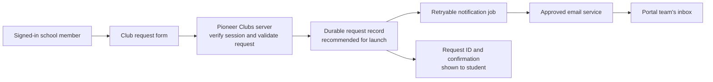

# Automated club website requests

**Decision document · 22 November 2026 · direct-send pilot implemented; live credentials and delivery unverified**

The direct-send Brevo and Resend paths described below are implemented in the repository. See [setup and operational limits](email-provider-setup.md). Durable storage, a worker, delivery webhooks, and a request status page remain future work.

## Executive decision

The form now uses **Send request**. A signed-in PCSS member completes the short form; when Brevo is configured, the server passes one notification to `pcss2robotics@pioneercss.org` from a verified portal sender. No email app opens. A request still starts a human review; it does not approve a club or publish a page.

**Zero-budget recommendation:** use a Vercel server function plus **Brevo Free** for one admin notification per request. At the checked date, Brevo allows **300 emails/day at $0** and supports transactional API sending and idempotency. Resend Free is equally viable for this low-volume form, with **100/day and 3,000/month**. Brevo has more free capacity; Resend's narrower, email-focused product may be easier for a small developer team to operate, but that is a workflow preference rather than a proven reliability advantage. Do not enable paid extras. For school-wide use where every request needs a durable receipt, add a request database and retryable worker when a suitable approved storage option is available. Verify production Google sign-in before promising a school-account-only form; earlier reports showed an OAuth `invalid_client` error, and this document does not establish its current status. Hosting cost and plan eligibility are separate: Vercel's free Hobby plan has usage and personal/non-commercial eligibility limits, so confirm the existing deployment's terms. [Brevo free limits](https://help.brevo.com/hc/en-us/articles/208580669-FAQs-What-are-the-limits-of-the-Free-plan), [Brevo idempotency](https://developers.brevo.com/changelog/2021/11/10), [Resend pricing](https://resend.com/pricing), [Vercel Hobby plan](https://vercel.com/docs/plans/hobby).

## Free email services checked

**Checked 22 November 2026.** These are published free-plan allowances, not a guarantee that a provider will approve this account or preserve its plan indefinitely. Each service still needs a sender/domain setup and a server-side credential. The existing `pcssclubs.org` domain can avoid buying a *new* domain if its DNS owner permits the required records.

| Provider | Published $0 allowance | Fit for one admin notification per request | Main caveat |
| --- | --- | --- | --- |
| **Brevo Free — recommended for $0 headroom** | **300/day**, including transactional email; no credit card required according to Brevo. | More free daily capacity, transactional API, and idempotency for retry protection. | Free emails carry Brevo branding; above the daily limit, up to 1,000 transactional emails enter a retry queue, and further emails are not delivered. Verify sender/domain and inspect actual delivery status before claiming success. [Plan and limits](https://help.brevo.com/hc/en-us/articles/208580669-FAQs-What-are-the-limits-of-the-Free-plan), [idempotency](https://developers.brevo.com/changelog/2021/11/10), [sender setup](https://developers.brevo.com/docs/getting-started-with-senders-and-domains). |
| **Resend Free — simpler alternative** | **3,000/month, 100/day; 3 domains** | Focused email API and a 24-hour idempotency key for safe near-term retries. | Verify a domain to send to the admin address; daily cap and provider account approval still apply. [Plan](https://resend.com/pricing), [idempotency](https://resend.com/changelog/idempotency-keys). |
| **Mailjet Free** | **6,000/month, 200/day**, with API access. | Useful alternate if a larger monthly allowance matters. | Above the daily limit, excess mail can queue and later expire; this complicates an immediate “sent” confirmation. [Plan](https://www.mailjet.com/pricing/), [limit behavior](https://documentation.mailjet.com/hc/en-us/articles/19154256993051-Understanding-Mailjet-Free-Plan-Limits). |
| **Postmark Developer** | **100/month**, no overages. | Fine for development and a very small pilot. | Too little headroom for a school-wide intake; marketed primarily for testing and side projects. [Plan](https://postmarkapp.com/pricing/). |

**How to choose:** for the stated $0 constraint, Brevo offers more capacity and is the default. Resend remains a reasonable alternative if the team prefers its focused interface; a single club-request email is unlikely to approach either limit, but that is an inference, not measured traffic. **Both** support idempotency, so it is not a reason to prefer one over the other. Use **one recipient and one email per request**; a student receipt consumes another email. When a limit is reached, preserve the form and give an accurate pending or failed status. Brevo may queue excess mail rather than immediately reject it, so “accepted” must never be presented as “delivered.” [Brevo limits](https://help.brevo.com/hc/en-us/articles/208580669-FAQs-What-are-the-limits-of-the-Free-plan), [Brevo transactional API](https://developers.brevo.com/docs/send-a-transactional-email), [Brevo idempotency](https://developers.brevo.com/changelog/2021/11/10), [Resend pricing](https://resend.com/pricing).

**Zero-budget setup:** create a free Brevo account, verify a portal-controlled sender/domain, set a server-only API key in Vercel, and send from that address to `pcss2robotics@pioneercss.org`. Use the signed-in school email as `Reply-To`, subject to provider acceptance. Test delivery to the monitored inbox before inviting students. If choosing Resend instead, verify the domain first: its shared `resend.dev` testing sender cannot serve as the production sender to the admin mailbox. The DNS and sender must be approved by whoever controls the domain. [Brevo sender setup](https://developers.brevo.com/docs/getting-started-with-senders-and-domains), [Vercel's Resend test-sender guidance](https://vercel.com/academy/build-and-launch-with-ai/prepare-email).

The email service *accepting* a message is not proof that it reached the inbox. The request record is the source of truth; delivery status is tracked separately.

## What the repository does today

- [`src/pages/SupportPage.tsx`](../src/pages/SupportPage.tsx) collects club name, campus, approval stage, optional advisor, and purpose. It submits within the site; no email app opens.
- [`src/data/supportCenter.ts`](../src/data/supportCenter.ts) formats the plain-text notification. The recipient defaults to `pcss2robotics@pioneercss.org` and can be changed only by server configuration.
- [`src/server/auth.ts`](../src/server/auth.ts) verifies encrypted session cookies. The request handler checks school-member eligibility **on the server**. A browser-supplied name, email, or role is not evidence of identity.
- The same handler runs through Vercel `api/` and local Express. Brevo sends when configured. There is still no shared request database or live delivery verification in this repository.

## Options

| Option | How it works | Strengths | Limits and setup | Fit |
| --- | --- | --- | --- | --- |
| **A. Transactional email API** | Vercel function validates the signed-in request and calls Brevo or Resend. | Fastest implementation; no email client; a verified sender and server-only API key; clear provider response. | Requires an approved account, DNS/sender verification, deliverability monitoring, and a plan for an accepted email that later bounces. Without a database, no durable request history. | **Best pilot** at low volume. |
| **B. Request record + email worker** | Function stores a request with a unique ID, then a job sends the notification. | Durable receipt, retries, duplicate protection, audit trail, and possible future request status. | Database, queue/worker, retention policy, and operational ownership add work and cost. | **Recommended school-wide architecture.** |
| **C. Google Workspace Gmail API** | A server-side service sends as an approved Workspace mailbox. | Keeps sending within an existing school mail environment if IT wants that. | Workspace administrator setup, Gmail API access, delegated authority or a managed mailbox OAuth flow, token/key custody, quotas, and support ownership. Domain-wide delegation is powerful and should be narrowly scoped. | Good only if PCSS IT approves and operates it. |
| **D. Amazon SES** | Vercel function or worker calls SES. | Mature AWS email infrastructure; sensible if PCSS already uses AWS. | AWS account/IAM, verified sender, sandbox exit, DNS, bounce handling, and more setup than a small portal needs. | Good with an existing AWS owner. |
| **E. Hosted form/workflow** | Embed or link an approved school form that emails or routes submissions. | Minimal custom backend; school may already have a retention and review workflow. | A separate interface and data store; sign-in and identity handoff may feel disconnected; customization and access rules depend on the platform. | Fallback if IT requires an existing school system. |

Resend supports an email API with idempotency keys; its documented deduplication window is **24 hours**. Postmark requires a confirmed sender signature or verified domain and supports a `ReplyTo` field. SES requires a verified sending identity and, while in its sandbox, restricts recipients. Google documents Gmail API sending and the administrative setup for domain-wide delegation. These are provider capabilities, not an endorsement of their cost or school suitability. [Resend idempotency](https://resend.com/changelog/idempotency-keys), [Postmark sending API](https://postmarkapp.com/developer/api/email-api), [Postmark sender verification](https://postmarkapp.com/developer/user-guide/managing-your-account/managing-sender-signatures), [Amazon SES identities](https://docs.aws.amazon.com/ses/latest/dg/verify-addresses-and-domains.html), [Google Workspace credentials](https://developers.google.com/workspace/guides/create-credentials), [Gmail sending](https://developers.google.com/workspace/gmail/api/guides/sending).

**Cost lens:** A can use Brevo's or Resend's $0 tier within its published limits, plus whatever hosting usage the site already incurs. B may add database and job processing charges unless an approved free allowance covers the load. C can avoid an additional email vendor but demands more school IT involvement. D is attractive when AWS operations already exist. Recheck plans and quotas before deployment because they can change.

## Current experience and future improvements

1. The student signs in with an eligible PCSS school account and opens **Request a club website**. Public help remains available without sign-in.
2. The form shows the account email as “We’ll reply to …”, asks only for the existing five fields, and says “Your request goes to the Pioneer Clubs team for review. This does not approve or publish a club.”
3. **Send request** disables while the request is in flight. After Brevo acknowledges the message, the site shows a short `PCR-…` reference and says it passed the request to the email service. The reference appears in the email but is not a durable ticket ID. The team can review the request when the email arrives. Do not promise a response time without an owner and service target.
4. If the server rejects a field, preserve the form and point to that field. If the provider is down, preserve the form and show **Try again**. If the site cannot verify the school session, offer **Sign in again** and a public support path. Never show “sent” based only on a button click.
5. Do not automatically send a second copy to the student until the team wants that behavior; the on-screen receipt is enough for the first release. If a copy is added, it should clearly say it is a receipt, not approval.

## Server contract and trust boundaries

Suggested endpoint: `POST /api/club-site-requests`, returning JSON with `requestId` and an explicit state. The same handler should back the Vercel function and local Express route. The browser sends only `{clubName, campusSlug, clubStatus, advisorName, purpose, submissionId}`. The server derives requester name and email from its verified session, resolves the campus against a server-controlled registry, and fixes the destination address in server configuration. It must not accept `to`, `from`, `role`, or `requesterEmail` from the request body.

| Result | HTTP response | What the UI may say |
| --- | --- | --- |
| Future record saved and notification queued | `202` with ID and `notificationStatus: "pending"` | “Request received. We’ll email the team.” |
| Configured provider accepted the send | `202` with ID and `notificationStatus: "accepted"` | “Request passed to the email service.” Avoid “delivered.” |
| Invalid input | `400` with field errors | Explain corrections, preserve entries. |
| No eligible session | `401` or `403` | Offer school sign-in or account switch; preserve entries. |
| Rate limit | `429` with safe retry guidance | Explain when to try again; no silent loss. |
| Storage/provider unavailable | `503` with safe retry guidance | No success message; keep form data. |

Security and privacy requirements:

- **Server authorization:** reuse the existing verified school-member rule. Do not rely on the client capability flag. Match the site's canonical origin and reject cross-origin state-changing requests; add CSRF protection appropriate to the cookie session. `SameSite=Lax` alone is defense in depth. [OWASP CSRF guidance](https://cheatsheetseries.owasp.org/cheatsheets/Cross-Site_Request_Forgery_Prevention_Cheat_Sheet.html).
- **Input and abuse controls:** enforce field length and enum limits on the server; reject oversized bodies and unexpected fields; use a shared rate limiter per account plus an abuse ceiling per network. An in-memory counter is unreliable across Vercel instances. Avoid HTML rendering of untrusted fields unless escaped. Keep messages plain text initially.
- **Identity and sender:** use a portal-owned, verified `From` address such as `requests@pcssclubs.org` *only if its owner approves and verifies the domain*. Set `Reply-To` to the verified school account when permitted by the mail provider. Never impersonate a student's or the school's domain as the sender. Use a monitored destination mailbox; confirm that `pcss2robotics@pioneercss.org` is the right intake address.
- **Data minimization:** collect no student roster, private contact details, or photos. Restrict request records and logs to the small support team; define a retention/deletion period with school administration before storing student submissions. Do not log full request bodies, session cookies, tokens, or provider keys. Reflect the new processing in the public privacy notice after review.
- **Secrets and environments:** keep mail credentials in server-only Vercel environment variables and local ignored env files. Never use a `VITE_` prefix or ship a key to the browser. Vercel says environment changes apply to new deployments, so verify the deployed environment after changing secrets. [Vercel environment variables](https://vercel.com/docs/environment-variables).

## Reliability design

For **Option A**, generate a unique `submissionId` before the first click and reuse it on retries. Send with a provider idempotency key when supported, and show success only after the provider acknowledges. A browser retry after an uncertain timeout can still produce duplicates without persistent server state, especially after the provider's deduplication window. This is acceptable only if the pilot team can manually reconcile occasional duplicates.

For **Option B**, create the request record under a unique `(requester identity, submissionId)` constraint. In the same database transaction, create a pending notification/outbox item. A worker reads the outbox, calls the provider with a stable key derived from the request ID, records its provider message ID, and retries transient failures. A separate alert catches items that remain pending or fail permanently. This makes the receipt independent of whether the email provider is temporarily available. Avoid treating a queue alone as permanent storage: Vercel Queues is currently beta, uses at-least-once delivery, and retains messages for a limited period; consumers must be idempotent. A Postgres integration can supply durable structured records. [Vercel Queues](https://vercel.com/docs/queues), [Vercel Marketplace storage](https://vercel.com/docs/marketplace-storage).

The email body should put the actionable facts first: request ID, school account, club, campus, approval stage, optional advisor, purpose, and time received. Label all student-entered statements as **unverified**. Include a link to an internal request record only if an authenticated admin view exists; otherwise do not create a public link containing student details. A delivery failure should be visible to the team through logs/alerts, without exposing provider diagnostics to students.

## Rollout plan

| Stage | Work | Release gate |
| --- | --- | --- |
| 1. Ownership | Confirm intake mailbox owner, approved sender/domain, chosen provider, who may access requests, retention period, and who responds. | School/portal owner has approved the data flow and sender identity. |
| 2. Identity | Verify production Google sign-in on the canonical site host and resolve any remaining failure; test school member, editor, signed-out, and ineligible accounts. | A new private-browser sign-in reliably reaches the support form. |
| 3. Pilot | Add shared server handler, provider adapter, validation, abuse controls, idempotency key, and clear form states. Test with a verified sender and a team test inbox. | Real delivery to the test inbox, duplicate retry, provider failure, and unauthorized request are all verified. |
| 4. Launch durability | Add request/outbox database, worker, monitoring, retention job, and privacy notice update. Migrate confirmation wording from “sent” to “received” with an ID. | Team can find every accepted request and see failed notifications. |
| 5. Operate | Review bounce/failure alerts and request backlog; rotate keys; periodically test sign-in and end-to-end delivery. | Named owner and documented recovery procedure. |

**Current path:** Option **A with Brevo Free or Resend Free**, one email to the admin inbox per request once configured. Use **B** before school-wide promotion if lost requests, duplicate messages, or uncertain handoff would be unacceptable. PCSS must still confirm ownership of the sending domain, intake mailbox, and student-data flow. No live delivery is claimed until an account and verified sender are configured and tested.
