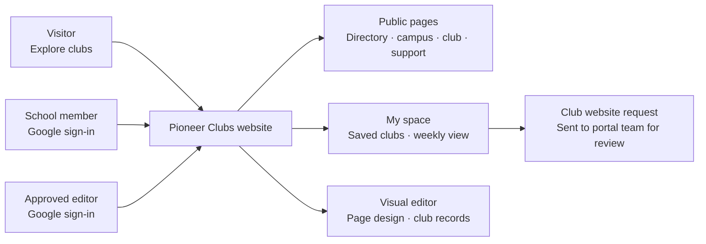
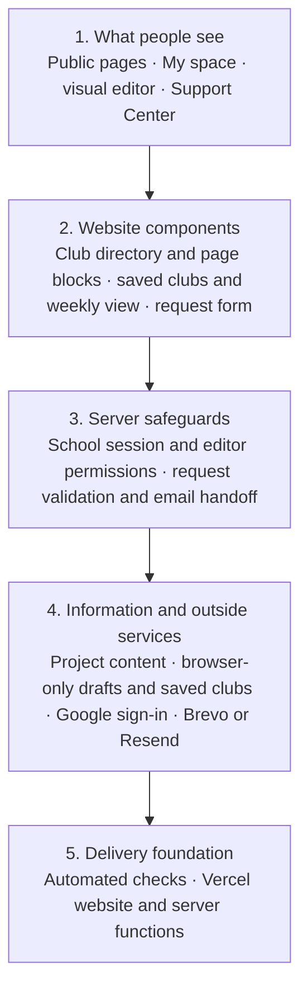
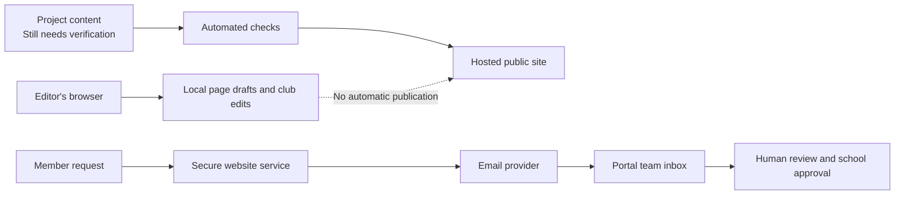

# Pioneer Clubs: the leadership view

**Updated November 22, 2026 · Based on the current repository and reported production behavior**

> **In one minute:** Pioneer Clubs is a student-run place to discover clubs across PCSS campuses. Anyone can browse. A school member can save clubs and request a club website. A small group of approved editors can design pages. The portal is still in development and awaits school administration approval. Its club details have not yet been verified for public launch.

## The experience, in three doors

| Person | What they can do | What they do not need to do |
| --- | --- | --- |
| **Visitor** | Browse the directory, campus and club pages, Support Center, credits, and policies. | Sign in to see public information. |
| **School member** | Sign in with an eligible school Google account; save clubs, see a personal weekly view, and submit a club website request. | Enter an editing area to use the portal. |
| **Approved editor** | Use the visual editor to work on home, campus, club, and credits pages and club records. | Give every member editing access. |

The site presents a clear way back to public browsing when sign-in is unavailable. Editing is a separate permission checked by the server; it is not a separate kind of Google account.

**A request is a starting point, not an approval.** The portal team reviews club details and any required school approvals before a page is made public.

## The platform in layers

Read this diagram from top to bottom: each layer supports the one above it. The labels describe responsibilities, so leaders can see where a change or problem belongs without knowing the code.

**Important boundary:** Public browsing does not require the sign-in safeguard. The server checks school identity for member actions and editor access. Browser-only data stays on that device; the current platform has no shared content database or request ticket store.

## How information reaches people

There are currently **two very different kinds of changes**:

1. **Shared website content** starts in the project, passes automated checks, and is deployed to the hosted site. This is how the current default club information and page designs reach visitors.
2. **Changes made in the visual editor** are saved in that editor's browser. Saved clubs are also kept in the member's browser, under their school account. Neither is a shared, cross-device publishing system today. An editor can export and import a snapshot, but that is a manual handoff.

This distinction matters: seeing an edit on one device does **not** mean every visitor sees it. A shared publishing service with review and rollback is the next architectural step if PCSS wants routine multi-editor updates.

The request form checks the signed-in school account on the server, validates the submission, and sends one notification through a configurable email service. Brevo and Resend adapters are implemented. The student's browser never receives the email key or chooses the recipient. When an email provider accepts a request, the site says it was **passed to the email service**; that does not prove inbox delivery. There is no shared request database or guaranteed ticket tracking yet.

## Where the project stands

| Area | Current state | Leadership implication |
| --- | --- | --- |
| **Public experience** | Directory, campus and club pages, Support Center, credits, and policies are implemented. Reusable visual blocks power home, campus, club, and credits content. | Review the content and experience with actual students and staff before promotion. |
| **School sign-in** | Member and editor permissions are implemented. The recent production request reached the email service from a signed-in account; that is evidence for this path, not proof of every sign-in journey. | Run a short production sign-in test across new, returning, switched, and signed-out accounts. |
| **Club information** | Checked-in club, advisor, schedule, and media details are explicitly marked unverified. Public search indexing remains held. | Assign a school reviewer and approve real details before launch. |
| **Editor and personal data** | Browser storage supports current drafts and saved clubs. There is no shared editor publishing or cross-device member sync. | Decide whether a pilot can use browser-local work or needs shared storage and review first. |
| **Club website requests** | In-site form, server checks, and replaceable email providers are implemented. The most recent reported production sends were rejected by Brevo with `401 unauthorized`. The cause is still unconfirmed; account IP restrictions are a plausible explanation. | Resolve provider access and confirm one test request in the monitored inbox before inviting students to use the form. |
| **Project status** | “To Be Approved” and “In Development” notices are centrally configurable and currently on by default. | Keep the notice until the respective approval and development work is complete. |

## Decisions that unlock a responsible launch

1. **Name content reviewers.** Confirm campus, club, advisor, meeting, media, credits, and policy details; decide who signs off on changes.
2. **Prove the complete request journey.** Resolve the production email rejection, then test from school sign-in through inbox receipt and a human response. Keep a clear alternate contact path while it is unavailable.
3. **Choose the publishing model.** A small pilot can use reviewed project releases and browser-local editor work. Broad, frequent editing needs shared storage, approval, audit history, and rollback.
4. **Define operating ownership.** Identify who monitors the intake inbox, handles corrections, manages access, and turns off the review notice after approval.

## For the delivery team

| Building block | Where it lives |
| --- | --- |
| Routes and page loading | [`src/App.tsx`](../src/App.tsx) |
| Public club data and publication gate | [`src/data/registry.ts`](../src/data/registry.ts), [`src/data/publication.ts`](../src/data/publication.ts) |
| Visual pages and local drafts | [`src/puck/`](../src/puck/), [`src/context/RegistryContext.tsx`](../src/context/RegistryContext.tsx) |
| Member space and browser-local saved clubs | [`src/pages/MySpacePage.tsx`](../src/pages/MySpacePage.tsx), [`src/context/SavedClubsContext.tsx`](../src/context/SavedClubsContext.tsx) |
| Sign-in and editor authorization | [`src/server/auth.ts`](../src/server/auth.ts), [`src/components/ProtectedEditorRoute.tsx`](../src/components/ProtectedEditorRoute.tsx) |
| Support and request delivery | [`src/pages/SupportPage.tsx`](../src/pages/SupportPage.tsx), [`src/server/clubSiteRequests.ts`](../src/server/clubSiteRequests.ts), [`src/server/email/`](../src/server/email/) |
| Review notice and release checks | [`src/data/siteReview.ts`](../src/data/siteReview.ts), [`package.json`](../package.json), [CI workflow](../.github/workflows/ci.yml) |

More detail: [email provider setup](email-provider-setup.md), [club request options](automated-club-site-requests.md), and [environment and release plan](environments-and-release.md). The release plan describes proposed stages; it does not mean every stage is deployed.
