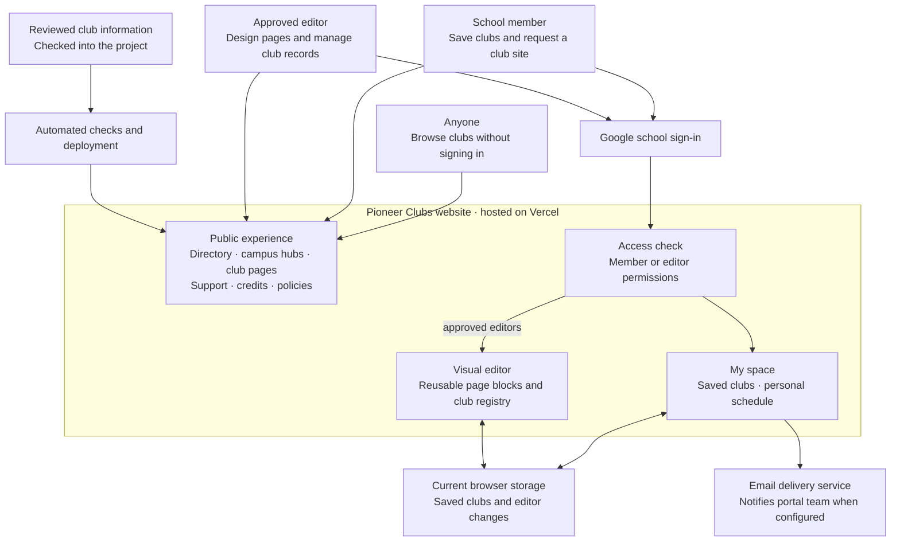

# Pioneer Clubs: how the portal fits together

**Leadership view · November 2026 · current repository, not a claim of live production readiness**

Pioneer Clubs gives everyone a place to discover student organizations. A verified school account adds a personal space. People granted editing access can shape club and campus pages. The same reusable page system serves the directory, each campus, and each club.

## What the diagram means

1. **Discovery stays open.** Visitors can browse public club information and support without an account. Sign-in is for personal features or authorized editing.
2. **Access follows the person's role.** Google confirms the school account; the portal checks whether that person is a school member or an approved editor. The editing route is restricted to the latter.
3. **Publication is deliberate.** Public club information is built from reviewed project records and deployed after automated checks. Editor changes and saved clubs currently remain in that browser. A signed-in member can send a club-site request within the site when email delivery is configured. The team reviews it before publishing anything.

## Current capability and next decision

| Area | In the repository today | Before a school-wide launch |
| --- | --- | --- |
| Public discovery | Searchable directory, campus and club pages, support, credits, and policies | Verify and approve real campus, club, advisor, schedule, and media details |
| School access | Google sign-in with separate member and editor permissions | Resolve and verify the production Google OAuth `401 invalid_client` configuration, then test sign-in on the production domain |
| Page creation | Reusable visual blocks for home, campus, club, and credits pages | Add shared, reviewed publishing if edits must appear across devices and for all visitors |
| Personal space | Saved clubs and a personal schedule | Add shared account storage if cross-device continuity is required |
| Club-site requests | Signed-in members can submit within the site; the server passes a notification to an email provider when configured | Verify the sender, intake mailbox, production sign-in, and live delivery; add durable records if guaranteed tracking is needed |

The current site is a working prototype. Its sample club data is marked **unverified** and public indexing is disabled. The review notice can be turned on or off by deployment configuration; it does not substitute for school approval.

## Component map for the delivery team

| Leadership concept | Main implementation |
| --- | --- |
| Public website and navigation | `src/App.tsx`, `src/pages/PortalDirectoryPage.tsx`, `src/pages/ClubSitePage.tsx` |
| Reusable page design | `src/puck/`, `src/pages/PuckDocumentPage.tsx` |
| Club directory and local edits | `src/data/registry.ts`, `src/context/RegistryContext.tsx`, `src/puck/pageLayoutStore.ts` |
| Sign-in and permissions | `api/auth/`, `src/server/auth.ts`, `src/context/AuthContext.tsx`, `src/components/ProtectedEditorRoute.tsx` |
| Personal space and requests | `src/pages/MySpacePage.tsx`, `src/context/SavedClubsContext.tsx`, `src/pages/SupportPage.tsx` |
| Release checks and hosting | `.github/workflows/ci.yml`, `scripts/generate-search-pages.ts`, `vercel.json` |

**Leadership proposition:** The portal already provides a coherent path from *discover a club* to *join the school community* to *give a club its own presence*. The next phase is to verify school content, make production sign-in reliable, and decide whether shared publishing is needed before inviting broader use.
